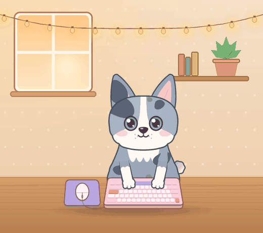

<div align="center">

#  DeskCorgi

**A tiny desktop corgi that sits behind its own little keyboard and mirrors everything you type and click.**

<p>
  <a href="https://github.com/Layfate/DeskCorgi/releases/latest"></a>
  <a href="https://github.com/Layfate/DeskCorgi/releases"></a>
  <a href="https://github.com/Layfate/DeskCorgi/stargazers"></a>
  
  <a href="LICENSE"></a>
</p>

<p>
  🐶 <a href="https://github.com/Layfate/DeskCorgi/releases/latest"><b>Download</b></a> ·
  🎨 <a href="#custom-skins">Custom skins</a> ·
  🛠️ <a href="#build-from-source">Build from source</a> ·
  🔒 <a href="#privacy">Privacy</a>
</p>

<p>
    
</p>

<sub>Native Windows app in Rust (Win32 + Raw Input + tiny-skia) · one ~1.2 MB exe · no installer · no network access</sub>

</div>

## Highlights

- **Lightweight:** a single ~1.1 MB executable with no installer or runtime, using about 14 MB of RAM.
- **Works in games:** input is read through Raw Input, so the corgi keeps reacting while a fullscreen game has focus.
- **Vector-drawn:** rendered every frame with tiny-skia, with a 2.5D head that follows your cursor.
- **Skinnable:** a skin is a small TOML file of colours, shape values and markings.
- **Private:** no network access, and key codes are never stored.

## Features

### The corgi

Red and white, big ears, a stub tail, and short legs with fluffy white socks and toe-bean paws.

It comes in five coats, picked from **Dog** in the menu: **Corgi** (red), **Tricolor**,
**Blue Merle** (with blue eyes), **Fawn** and **Sable**.

### Keyboard and mouse mirroring

- The corgi's paws tap the matching keys on its own (mirrored) keyboard.
- Each key you press can pop up as a small keycap with its label. This can be turned off.
- One paw follows your mouse, and its buttons light up when you click.
- Three keyboard themes, **Cream**, **Charcoal** and **Sakura**, plus an optional rainbow key sweep.

### Reactions

| When you… | The corgi… |
| :--- | :--- |
| type | taps the matching keys, each paw staying on its own side |
| hold 3 or 4 keys | lifts one or both back paws onto the extra keys |
| type fast | narrows its eyes, perks its ears and wags harder |
| move the cursor | turns its head and eyes to watch it |
| shake the cursor quickly | plays chase |
| hover back and forth over its head, or click it | gets petted |
| click rapidly (8 times in about a second) | does zoomies |
| drag it | dangles by the scruff and swings |
| press Backspace a few times quickly | tilts its head, puzzled, with a little "?" |
| leave it alone for a while | gives a big sleepy yawn now and then |
| stay idle for 5 minutes | yawns, then naps on the keyboard |

## Installation

1. Download `DeskCorgi-Windows-x64.exe` from [Releases](https://github.com/Layfate/DeskCorgi/releases/latest), or `DeskCorgi-Windows-x64.zip` for the app together with the skin templates.
2. Run it. No installation is needed.
3. Right-click the corgi or its tray icon to open the menu (dog, size, eye colour, keyboard theme, behaviour, click-through, position lock, always on top, stream mode and start with Windows).
4. Drag the corgi to move it. Its position is remembered.

Settings are saved in `%APPDATA%\DeskCorgi\config.toml`.

### Gaming and streaming

- **Click-through:** toggle with <kbd>Ctrl</kbd>+<kbd>Alt</kbd>+<kbd>Shift</kbd>+<kbd>D</kbd>. While it is on, hold <kbd>Alt</kbd> to drag or right-click the corgi. Launching `DeskCorgi.exe` again also turns click-through off and opens the menu.
- **Elevated games:** games running as administrator hide keystrokes from normal apps. Use **Restart as administrator** in the menu.
- **Stream mode:** draws the corgi on a solid `#00FF00` background for chroma keying in OBS.
- **Frame rate:** *Smooth* (default) matches your display's refresh rate while animating and drops to 30 fps when idle. *Balanced* caps at 60 fps and *Power saver* at 30 fps.

### FAQ

- **Windows SmartScreen blocks the app.** The executable is not code-signed yet. Choose *More info → Run anyway*, or build it from source.
- **The corgi stops reacting in a game.** The game is likely running as administrator. Use **Restart as administrator**.
- **I don't want my keys visible on stream.** Turn off **Keyboard → Show typed keys**.

## Custom skins

A skin is a TOML file. Start from a template in [`skins/`](skins) (one per built-in coat, e.g. [`corgi.toml`](skins/corgi.toml)), then load it with **Dog → Import skin…** or drop the file onto the corgi.

- Only `format_version`, `name` and `palette.body` are required.
- Numeric values are clamped to their allowed range (listed in the template comments), and unknown fields are ignored.
- Invalid types, colours or missing required fields are rejected with a clear error message.
- Extra `shape` styles are available beyond the built-ins: `tail_style = "curl"` or `"plume"`, `face = "urajiro"`, `chest = "bib"` and `brows = true`.
- Optional `[[regions]]` (closed Bézier shapes) and `[[marks]]` (polygons or strokes) add markings to a part: `head`, `skull`, `muzzle`, `body`, `tail`, `ear_l` or `ear_r`. Markings move with their part.

## Build from source

Requires stable Rust and, on Windows, the MSVC build tools.

```bash
cargo build --release      # target/release/DeskCorgi.exe
cargo test --workspace
```

### Project layout

```text
DeskCorgi/
├── app/                    # DeskCorgi.exe binary, manifest and icon
├── crates/
│   ├── core/               # platform-independent input model, moods, rig, skins and renderer
│   └── platform-windows/   # Win32 window, Raw Input, tray icon and menu
├── art/                    # SVG paths and 2.5D keyframes for the dog
├── skins/                  # skin templates for the built-in corgis
└── assets/                 # README images
```

## Contributing

Issues and pull requests are welcome. Before opening a PR, run:

```bash
cargo test --workspace
cargo clippy --workspace --all-targets -- -D warnings
```

CI runs both on Windows, Linux and macOS. For changes to the dog's artwork, see [`art/README.md`](art/README.md).
The demo GIFs at the top are rendered from the real animation code: `sh tools/demo_gifs.sh` (needs ffmpeg) rebuilds them.

## Privacy

- Key codes are only used to choose a paw and highlight a key for the current frame. They are never stored, logged or transmitted.
- When **Show typed keys** is on (the default), each key label is displayed for about a second and then discarded. Turn it off before typing passwords on stream or during screen sharing.
- The only statistic is an in-memory "keys this session" counter, which can be disabled.
- DeskCorgi makes no network connections.

## Similar projects

- [KuroCat](https://github.com/chanke17/KuroCat): another tiny desktop companion that types along with you.

## License

Released under the [MIT License](LICENSE).
