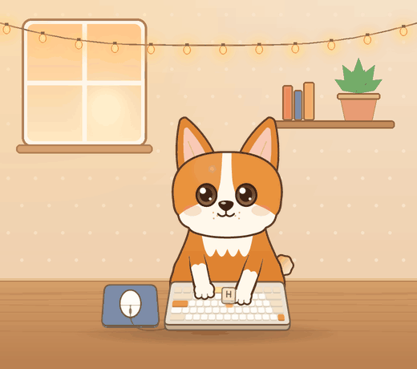
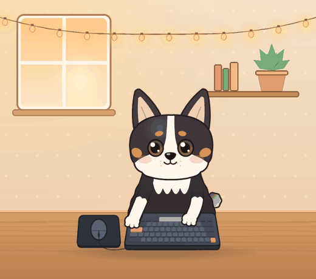
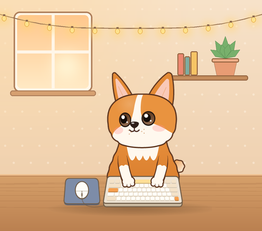
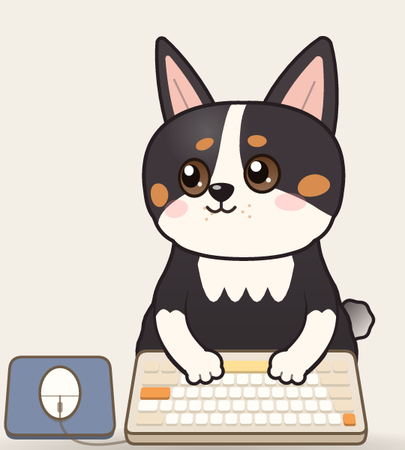
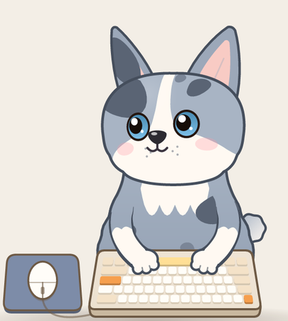
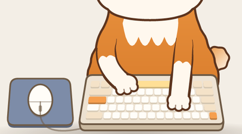
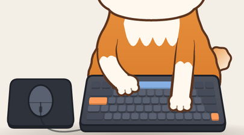
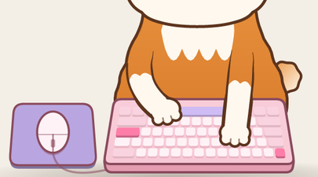

<div align="center">


# 🐶 DeskCorgi

**A tiny desktop corgi that sits behind its own little keyboard and copies everything you type and click.**

<p>
  <a href="https://github.com/Layfate/DeskCorgi/releases/latest"></a>
  <a href="https://github.com/Layfate/DeskCorgi/releases"></a>
  <a href="https://github.com/Layfate/DeskCorgi/stargazers"></a>
  
  <a href="LICENSE"></a>
</p>

<p>
  ⬇️ <a href="https://github.com/Layfate/DeskCorgi/releases/latest"><b>Download</b></a> ·
  🎨 <a href="#-custom-skins">Custom skins</a> ·
  🛠️ <a href="#-install--use">Build from source</a> ·
  🔒 <a href="#-privacy">Privacy</a>
</p>

<p>
  
  
  
</p>

<sub>Native Rust · Win32 + Raw Input · tiny-skia vector renderer · one ~1.1 MB exe, no runtime</sub>

</div>

---

## 💡 Why DeskCorgi?

| | 🐶 DeskCorgi | Typical Electron / web desktop pet |
| :--- | :--- | :--- |
| 📦 **Download** | One `DeskCorgi.exe`, about 1.1 MB, nothing to install | Ships a whole browser engine |
| 🧠 **Memory** | About 14 MB of RAM | Usually hundreds of MB |
| 🎮 **Games** | Reads input with Raw Input, so it keeps reacting while a game has focus | Often stops reacting in fullscreen games |
| 🖌️ **Art** | Vector-drawn every frame with a 2.5D head that follows your cursor | Fixed sprite sheets |
| 🎨 **Skins** | A skin is a small text file: colours, shape numbers and markings | Image packs |
| 🔒 **Privacy** | No network access at all; key codes are never stored | Varies |

---

## ✨ Features

- **Three built-in corgis**, switchable any time from the menu:
  - **Corgi** (default): red and white, big ears, short legs, a stub tail that wiggles the whole rear end.
  - **Tricolor Corgi**: black coat with tan eyebrow dots and tan cheeks, white blaze, chest and socks.
  - **Blue Merle Corgi**: blue-grey coat with darker merle patches (one dark ear), white trim and blue eyes.
- **Mirrors your keyboard and mouse:**
  - Its paws tap the keys you press on its own little keyboard, which faces the dog, so it is mirrored.
  - Each key you press **pops up as a little keycap** with its label, then floats away. You can turn this off.
  - One paw works its own mouse while you use yours, and clicks light up the buttons.
- **Cute keyboards:** three themes (`Cream`, `Charcoal`, `Sakura`), each with two-tone keycaps, accent `Esc` / `Enter` keys and a pastel space bar. There is also an optional rainbow key sweep.
- **Lots of little moods:**

| You… | The corgi… |
| :--- | :--- |
| type | taps the matching keys, with each paw staying on its own side |
| hold 3 or 4 keys | lifts a back paw (or both) onto the extra keys |
| type fast | gets its focused face (narrowed eyes, a 💢 mark, concentration tongue), perks its ears and wags harder |
| move the mouse | puts a paw on its own mouse and follows along |
| move the cursor | turns its head and eyes to watch it |
| shake the cursor fast | plays chase: huge eyes, open mouth, tail going wild |
| hover back and forth over its head, or click its head | gets petted: happy eyes, blush, hearts |
| spam clicks (8 in about a second) | does zoomies: hops and sparkles |
| drag it | dangles by the scruff and swings |
| do nothing for 5 minutes | naps on the keyboard (Z z z) |

- **Gaming friendly:** full click-through mode with a global hotkey, a solid-green **stream mode** for OBS chroma key, and frame pacing locked to your display's refresh rate (60/75/120/144 Hz…) that drops to 30 fps when idle.

<details>
<summary><b>🖼️ Preview gallery</b></summary>
<br/>

| Corgi | Tricolor Corgi | Blue Merle Corgi |
| :---: | :---: | :---: |
|  |  |  |

| Cream | Charcoal | Sakura |
| :---: | :---: | :---: |
|  |  |  |

</details>

---

## 📦 Install & Use

### 🪟 Windows 10 / 11

1. Download `DeskCorgi.exe` from [GitHub Releases](https://github.com/Layfate/DeskCorgi/releases/latest).
2. Run it. There is nothing to install, and the corgi appears on your desktop.
3. **Right-click the corgi** or click the **tray icon** for the menu: dog, size, eye colour, keyboard theme and typed-key pop-ups, behaviour toggles, click-through, lock position, always on top, stream mode and start with Windows.
4. **Drag** the corgi to move it. Its position is remembered.

<details>
<summary><b>🎮 Gaming, streaming and frame rate</b></summary>
<br/>

- **Full click-through:** toggle with <kbd>Ctrl</kbd>+<kbd>Alt</kbd>+<kbd>Shift</kbd>+<kbd>D</kbd>. While it's on, hold <kbd>Alt</kbd> to drag or right-click the corgi. Starting `DeskCorgi.exe` again also turns click-through off and opens the menu.
- **Games running as administrator** hide keystrokes from normal apps. Use *Restart as administrator* in the menu.
- **Stream mode** puts the corgi on a solid `#00FF00` background so OBS window capture can chroma-key it.
- **Frame rate:** *Smooth* (the default) follows your display's refresh rate while the corgi moves and drops to 30 fps when idle. *Balanced* caps it at 60 fps and *Power saver* at 30 fps.
- Settings are saved in `%APPDATA%\DeskCorgi\config.toml`.

</details>

<details>
<summary><b>🛠️ Build from source</b></summary>
<br/>

Requires Rust (stable) and, on Windows, the MSVC build tools.

```bash
cargo build --release            # target/release/DeskCorgi.exe
cargo test --workspace           # core logic, skins, renderer
cargo run -p deskcorgi-core --example render_poses   # writes out/poses.png (every pose, every dog)
cargo run -p deskcorgi-core --example export_skins   # regenerates skins/*.toml from the built-ins
cargo run --release -p deskcorgi-core --example bench
```

</details>

<details>
<summary><b>❓ FAQ</b></summary>
<br/>

- **Windows SmartScreen says "Windows protected your PC".** The exe isn't code-signed yet. Click *More info → Run anyway*, or build it yourself from source.
- **The corgi stops reacting in a game.** The game probably runs as administrator: use *Restart as administrator* in the menu.
- **I don't want my keys shown on stream.** Turn off **Keyboard → Show typed keys**.

</details>

---

## 🎨 Custom skins

A skin is a TOML file. Start from [`skins/corgi.toml`](skins/corgi.toml), [`skins/corgi_tricolor.toml`](skins/corgi_tricolor.toml) or [`skins/corgi_merle.toml`](skins/corgi_merle.toml) (the merle shows how `[[marks]]` make patches). Change the colours and shape numbers, then use **Dog → Import skin…** or drop the file onto the corgi.

- Only `format_version`, `name` and `palette.body` are required.
- Numbers are clamped to their allowed range (shown in the template comments), and unknown fields are ignored.
- A wrong type, a bad colour or a missing required field rejects the file with a clear message.
- `shape` also offers styles none of the built-ins use: `tail_style = "curl"` or `"plume"`, `face = "urajiro"`, `chest = "bib"` and `brows = true` (good for a Shiba).
- Optional `[[regions]]` (closed Bézier shapes) and `[[marks]]` (polygons or strokes) add markings in a part's own coordinates. Parts are `head`, `skull`, `muzzle`, `body`, `tail`, `ear_l` and `ear_r`, and markings move with their part.

---

## 🤝 Contributing

Issues and pull requests are welcome. Please run `cargo test --workspace` and `cargo clippy --workspace --all-targets -- -D warnings` before opening a PR; CI runs both on Windows, Linux and macOS.

<details>
<summary><b>📁 Project layout</b></summary>
<br/>

```text
DeskCorgi/
├── app/                    # the DeskCorgi.exe binary
│   └── windows/            # app manifest and the logo icon
├── crates/
│   ├── core/               # platform-independent: input model, moods, spring rig, skins, renderer
│   └── platform-windows/   # Win32 window, Raw Input, tray icon and menu
├── skins/                  # skin templates (the three built-in corgis)
├── assets/                 # logo, demo GIFs and previews for this README
└── IMPLEMENTATION_PLAN.md  # design notes and milestones (Linux and macOS come later)
```

</details>

---

## 🔒 Privacy

1. Key codes are only used to pick a paw and light up a key for the current frame. They are never stored, logged or sent.
2. With **Keyboard → Show typed keys** on (the default), the label of each key you press is shown on screen for about a second, then forgotten. Turn it off before typing passwords on stream or in a screen share.
3. The only counter is "keys this session". It is kept in memory, shown in the menu, and can be turned off.
4. No network access at all.

---

## ⭐ Star History

<a href="https://star-history.com/#Layfate/DeskCorgi&Date">
  <picture>
    <source media="(prefers-color-scheme: dark)" srcset="https://api.star-history.com/svg?repos=Layfate/DeskCorgi&type=Date&theme=dark" />
    <source media="(prefers-color-scheme: light)" srcset="https://api.star-history.com/svg?repos=Layfate/DeskCorgi&type=Date" />
    
  </picture>
</a>

---

## 📄 License

Released under the [MIT License](LICENSE).

Inspired by [KuroCat](https://github.com/chanke17/KuroCat) (MIT). DeskCorgi is a separate Rust implementation with its own dogs; see `IMPLEMENTATION_PLAN.md` §12.
